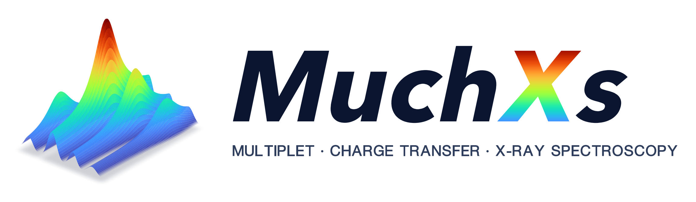
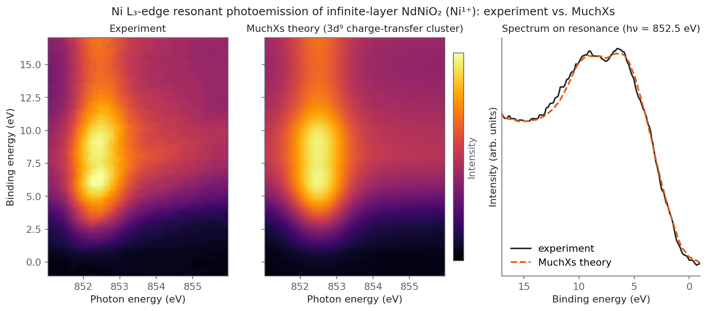

  

<b>Charge-transfer multiplet theory for X-ray spectroscopy</b> 
Spectral simulations and automated analysis of experimental spectra: XAS · XRS · PES · XES · RPES · RIXS

  <a href="https://muchxs.streamlit.app/"><b>Open the MuchXs web app</b></a>

---

MuchXs is a free platform for simulating and fitting core-level X-ray spectra of transition-metal and rare-earth compounds with charge-transfer multiplet theory. A single Hamiltonian and one parameter set produce every spectrum, so XAS, XRS, PES, XES, RPES and RIXS can be fitted to experiment together and give a consistent description of the electronic ground state.

MuchXs is designed and developed by Dr. Qijun Che (SLAC National Accelerator Laboratory, Stanford University; ORCID [0009-0008-5805-7727](https://orcid.org/0009-0008-5805-7727)).

## Use MuchXs

**Web app:** <https://muchxs.streamlit.app/>. Runs in the browser, with no installation or account needed.

> **If the web app shows an error or does not load,** please wait a few minutes and try again. The app is hosted on Streamlit Community Cloud, and short outages or a "waking up" screen come from the hosting service, not from MuchXs.

Desktop packages for macOS (Apple Silicon) and Windows will be published under [Releases](../../releases).

## What it calculates

| | |
|---|---|
| **Elements** | 3d transition metals (Sc–Zn), 4d transition metals (Y–Cd), rare earths (La–Lu), in any valence with an open valence shell |
| **Spectroscopies** | XAS, X-ray Raman (XRS), core and valence photoemission (PES), X-ray emission (XES), resonant photoemission (RPES), resonant inelastic X-ray scattering (RIXS) |
| **Edges** | e.g. L₂,₃ and M₂,₃ (3d and 4d), M₄,₅ and N₄,₅ (4f) |
| **Hamiltonian** | full atomic multiplets (Slater integrals Fᵏ, Gᵏ scaled from Hartree–Fock); spin–orbit coupling of core and valence shells; crystal field (10Dq, Ds, Dt for d; B⁴₀, B⁶₀ for f); charge transfer (Δ, Uvv, Ucv, hybridisation V); temperature (Boltzmann average over low-lying states) |
| **Configurations** | ground state vⁿ + vⁿ⁺¹L + vⁿ⁺²L² + …, with a user-chosen number of ligand-hole configurations (0 = atomic limit) |
| **Analysis** | comparison with a curated database of experimental spectra or with the user's own data; fitting of energy shift and broadening; digitising of published figures; Tanabe–Sugano diagrams |

   
  <i>Ni L₃-edge resonant photoemission of infinite-layer NdNiO₂ (Ni¹⁺): measured map (left), MuchXs charge-transfer multiplet calculation (middle), and the spectrum on resonance (right).</i>

## Workflow

1. **Elements:** pick an ion and see its edges, related literature and available experimental data.
2. **Model setup:** choose valence, edge, configurations and parameters, then run.
3. **Compare:** overlay experimental data from the database or your own file, and fit shift and broadening.
4. **Refine:** adjust model parameters and run again. RIXS starts from the same ion and parameters.

## Citing MuchXs

If you use MuchXs in published work, please cite it (see [`CITATION.cff`](CITATION.cff), or use **"Cite this repository"** on the right of this page):

> Q. Che, *MuchXs: charge-transfer multiplet theory for X-ray spectroscopy*, 2026. https://github.com/qijun-cloud/MuchXs-release

Experimental spectra in the database come from the cited publications. Please also cite the original sources.

## Licence

MuchXs is free for non-commercial academic research and teaching. See [`LICENSE.txt`](LICENSE.txt). For other uses, collaborations, feedback or bug reports, open an [issue](../../issues) or contact Dr. Qijun Che (cqijun@stanford.edu).

Copyright © 2026 Dr. Qijun Che.
